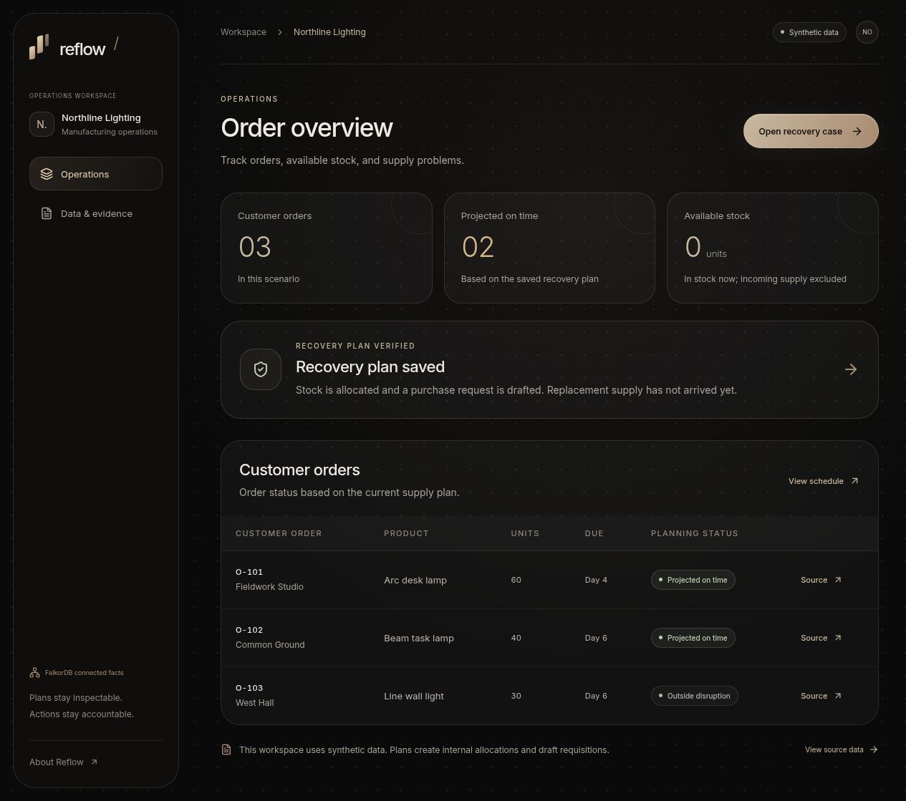
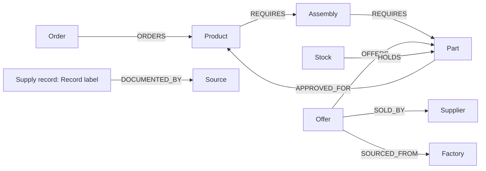

<p align="center">
  
</p>

<p align="center"><strong>Keep the work moving.</strong></p>
<p align="center">Trace supply disruptions, find workable alternatives, and save an approved recovery plan.</p>

<p align="center">
  <a href="https://app-production-e384.up.railway.app">Live app</a> |
  <a href="#try-it">Try it</a> |
  <a href="#the-graph">Graph model</a> |
  <a href="#quick-start">Quick start</a> |
  <a href="CONTRIBUTING.md">Contribute</a>
</p>

<p align="center">
  <a href="https://github.com/Allen-Saji/reflow/actions/workflows/verify.yml"></a>
  <a href="LICENSE"></a>
</p>

## What is Reflow?

Reflow is an open-source supply recovery app built with FalkorDB, TypeScript and the Model Context Protocol (MCP). When a factory becomes unavailable, it follows the supply network to affected customer orders, checks replacement offers, and records a recovery plan after user approval.

A cheaper supplier can still depend on the same disrupted factory. Reflow queries those relationships before considering price, then checks component approval, quantity, delivery dates, assembly capacity and budget. Every proposal keeps its source evidence and recorded tool activity available for inspection.



### What you can do

- Report a factory disruption and trace its impact through components, assemblies, products and orders.
- Run a model-selected MCP investigation or use the labeled guided mode without an API key.
- Compare replacement offers with explicit eligibility reasons and query-returned evidence paths.
- Review quantities, projected delivery dates, uncovered demand and additional cost before approval.
- Approve internal stock allocations and a draft purchase requisition, then verify the saved graph records.
- Inspect source records, change an uncommitted quote, import/export structured JSON, and compare fresh scenarios.
- Switch between light and dark themes with a saved browser preference.

## Try it

[Open the live app](https://app-production-e384.up.railway.app). Each visitor gets a browser-cookie workspace isolated from other visitors.

1. Click **Open the sample workspace**.
2. Select **Report disruption** and keep Factory Z unavailable through Day 8 with a $200 additional cost limit.
3. Create the recovery case, choose an investigation mode, and click **Find recovery options**. Guided mode uses the same MCP tools without model inference.
4. Inspect **Impact** and **Options**: two orders are affected, Beacon shares Factory Z, and Cobalt's 12V component is incompatible.
5. Open **Review recovery plan**. The baseline uses 20 on-hand drivers and 80 expected Delta drivers at a $160 premium.
6. Click **Approve recovery plan**, then **Approve and verify**. Inspect the saved allocations, draft requisition and downloadable receipt. **Activity** shows the recorded tool calls.
7. In **Data & evidence**, open the fresh **50-unit scenario** and repeat. The plan reports 30 uncovered units instead of inventing supply.

The live app runs the workflow; a screenshot is only a view of a saved result. Model-selected investigation depends on provider availability and preview quotas. Guided mode remains available.

## Sample data and results

Northline Lighting, its suppliers, customers and source documents are **synthetic**. The importable dataset is [examples/northline-lighting.json](examples/northline-lighting.json), generated from the [sample fixture](src/domain/fixture.ts). These are reproducible planning results, not customer outcomes or realized savings.

### Orders

| Order | Product         | Units | Due   | Factory Z disruption                       |
| ----- | --------------- | ----: | ----- | ------------------------------------------ |
| O-101 | Arc desk lamp   |    60 | Day 4 | Affected; requires DRV24                   |
| O-102 | Beam task lamp  |    40 | Day 6 | Affected; requires DRV24                   |
| O-103 | Line wall light |    30 | Day 6 | Outside the modeled disruption; uses DRV12 |

### Replacement checks

| Supplier | Quote                | Arrival | Recorded source | Decision for affected orders                                      |
| -------- | -------------------- | ------- | --------------- | ----------------------------------------------------------------- |
| Atlas    | 80 DRV24 at $10/unit | Day 2   | Factory Z       | Exposed; no independent finished stock                            |
| Beacon   | 100 DRV24 at $9/unit | Day 2   | Factory Z       | Cheaper, but exposed to the same factory                          |
| Cobalt   | 100 DRV12 at $8/unit | Day 1   | Factory Q       | 12V component is not approved for the affected 24V products       |
| Delta    | 80 DRV24 at $12/unit | Day 2   | Factory Q       | Compatible, approved and available under the recorded assumptions |

The two affected orders need 100 drivers. The warehouse has 20. Assembly takes one day and delivery takes one day; the sample capacity is 100 units per day.

| Checked result                                 | Baseline: 80 Delta units | Fresh scenario: 50 Delta units |
| ---------------------------------------------- | -----------------------: | -----------------------------: |
| On-hand drivers used                           |                       20 |                             20 |
| Expected replacement drivers                   |                       80 |                             50 |
| Affected orders projected complete and on time |                   2 of 2 |                         1 of 2 |
| Uncovered driver demand                        |                        0 |                             30 |
| Draft purchase value                           |                     $960 |                           $600 |
| Additional cost versus $10 baseline            |                     $160 |                           $100 |
| Additional cost limit                          |                     $200 |                           $200 |

The baseline premium is `80 x ($12 - $10) = $160`; the draft purchase value is `80 x $12 = $960`. Partial allocations do not count as complete shipments. See the [planner tests](tests/planner.test.ts) and [FalkorDB integration tests](tests/integration.test.ts).

## The graph

FalkorDB stores the supply network, source evidence and recovery workflow. Each workspace has a separate graph. These are the actual node labels and relationship directions created by [src/graph/store.ts](src/graph/store.ts):



Factories, suppliers, parts, products, orders, offers and stock also carry the `Record` label and link to their source. Sources are `Record:Source` nodes. Assemblies are generated from product requirements. Workspace settings store the current disruption and data revision.

### Where graph results change the decision

| Graph operation                              | Returned fact                                                            | Effect on the recovery                                                             |
| -------------------------------------------- | ------------------------------------------------------------------------ | ---------------------------------------------------------------------------------- |
| Trace factory-to-order dependency paths      | Factory Z connects through offers, DRV24 and assemblies to O-101/O-102   | Determines which orders require recovery; O-103 remains outside the modeled impact |
| Follow each offer's upstream factory path    | Atlas and Beacon both connect to Factory Z                               | Rejects production-dependent supply without independently held finished stock      |
| Traverse component approval edges            | DRV24 is approved for desk/task lamps; DRV12 is approved for wall lights | Prevents substituting Cobalt's cheaper incompatible component                      |
| Read source nodes referenced by evidence IDs | Quote, inventory, specification and disruption records                   | Makes the inputs and decision evidence inspectable                                 |
| Guard the approved write and read it back    | Exact revision, allocations and draft requisition                        | Blocks stale proposals and verifies the saved result                               |

The agent calls `trace_disruption`, which runs this parameterized impact query:

```cypher
MATCH p=(f:Factory {id:$factory})<-[:SOURCED_FROM]-(offer:Offer)
  -[:OFFERS]->(part:Part)<-[:REQUIRES*1..5]-(product:Product)
  <-[:ORDERS]-(o:Order)
RETURN o.id AS orderId,
       [n IN nodes(p) | n.id] AS ids,
       [n IN nodes(p) | coalesce(n.name,n.id)] AS names
```

For the sample disruption, `$factory` is `factory_z`. The returned paths include generated assembly nodes such as `desk_assembly`. Supplier exposure is queried separately:

```cypher
MATCH p=(o:Offer)-[:SOURCED_FROM*1..5]->(f:Factory {id:$factory})
RETURN o.id AS id, [n IN nodes(p) | n.id] AS ids
```

The first query identifies affected demand; the second exposes Beacon's shared dependency. Those query results and graph approval edges feed the deterministic planner. Quantities, costs and eligibility come from the recorded graph data and deterministic checks. Full schema, approval queries and write/readback details are in [Architecture](docs/architecture.md).

## Agent and approved actions

The app uses the official MCP SDK client/server protocol over linked in-memory transports. In model-selected mode, the configured model discovers and chooses investigation tools. Guided mode invokes a fixed sequence through the same MCP connection.

| MCP tool                    | Responsibility                                                                         |
| --------------------------- | -------------------------------------------------------------------------------------- |
| `trace_disruption`          | Query affected orders and dependency paths                                             |
| `find_replacement_offers`   | Query upstream exposure and approvals, then check eligibility                          |
| `get_evidence`              | Read the requested source records                                                      |
| `evaluate_recovery_options` | Compute, independently validate and persist a proposal                                 |
| `commit_approved_plan`      | Save internal allocations and a draft requisition using a server-generated approval ID |
| `verify_recovery_plan`      | Read saved records and compare them with the committed plan                            |

The model receives only the four investigation tools. The application requires explicit user approval for execution, bound to the proposal's exact data revision. Approval creates an `Approval` node linked to the plan. The guarded commit creates `Allocation` nodes and a draft `Requisition`; independent readback marks the plan verified. Repeated commits return the saved result. A source edit invalidates an unexecuted proposal, and committed scenarios lock source edits.

The planner ranks complete on-time orders, earlier deadlines, total coverage, then lower additional and purchase cost. It uses integer USD cents and bounded search, reports search-limit exhaustion, and validates proposals separately. Numerical UI summaries come from checked plan values.

## Quick start

Requirements: **Node.js 22.12+**, **pnpm 10.8.1**, and **Docker with Compose**. Node 22.16.0 is used by CI and the Docker image.

```sh
git clone https://github.com/Allen-Saji/reflow.git
cd reflow
corepack enable
corepack prepare pnpm@10.8.1 --activate
pnpm install --frozen-lockfile
cp .env.example .env
```

Set `COOKIE_SECRET` in `.env` to a random value of at least 32 characters. Then start the database and app:

```sh
docker compose up -d
pnpm build
pnpm start
```

Open **http://127.0.0.1:3410**. Select guided investigation for a complete local workflow without an inference API key.

To enable model-selected investigation, set `OPENROUTER_API_KEY` and optionally `OPENROUTER_MODEL` in `.env`; the default model is `openai/gpt-4.1-mini`. These runs send investigation requests and supplied records to OpenRouter and the selected provider. Use public or synthetic data you can share.

For frontend development, run `pnpm dev` and `pnpm dev:web` in separate terminals, then open **http://127.0.0.1:3411**. Rebuild with `pnpm build` to update the single-server preview.

## Development and verification

| Command         | Purpose                                                                |
| --------------- | ---------------------------------------------------------------------- |
| `pnpm dev`      | Start the TypeScript API server                                        |
| `pnpm dev:web`  | Start Vite with the API proxy                                          |
| `pnpm build`    | Strict TypeScript checking and frontend build                          |
| `pnpm test`     | Planner, API, graph integration and MCP tests; requires FalkorDB       |
| `pnpm test:e2e` | Browser recovery, reload, source revision and phone interaction checks |

Before the first browser test run:

```sh
pnpm exec playwright install chromium --only-shell
pnpm build
pnpm test
pnpm test:e2e
```

Keep port 3411 free for the browser test server. GitHub Actions runs the build, domain/API/MCP tests and browser workflows against a real FalkorDB instance. Tests cover shared upstream exposure, incompatible parts, independent finished stock, budget limits, stale approvals, duplicate commits, workspace isolation and shortages.

## Stack and project structure

| Layer                      | Technology                                  |
| -------------------------- | ------------------------------------------- |
| Interface                  | React, Vite, React Router, React Flow, GSAP |
| API and validation         | Fastify, TypeScript, Zod                    |
| Domain storage and queries | FalkorDB, parameterized Cypher              |
| Agent tools                | Official Model Context Protocol SDK         |
| Optional model inference   | OpenRouter tool calling                     |
| Verification               | Vitest, Playwright, GitHub Actions          |

```text
src/domain/    Fixture schema, sample data, planner and independent validation
src/graph/     Graph creation, traversal, approval, commit and readback
src/server/    HTTP API, model investigation and MCP transports
src/web/       Dashboard, recovery case, data and evidence interface
tests/         Domain, graph integration, API and MCP tests
e2e/           Browser workflows
examples/      Importable synthetic dataset
docs/          Architecture, operations and design system
```

## Scope and deployment

This is a small-scenario preview: up to three customer orders, four offers and 250 ordered units, with one committed recovery per scenario. It models one critical component per product. Expected supply is not received inventory; a draft requisition does not purchase or reserve external stock, and projected delivery is not a delivery guarantee.

Workspace access uses a three-day browser cookie. There are no accounts, team permissions or account recovery. Hosted inference/concurrency limits are process-local; graph records have no automated retention or configured backups. Do not use the preview for confidential procurement data or production purchasing.

See [Operations and deployment](docs/operations.md) for environment variables, database persistence, quotas, health checks and the local MCP stdio entrypoint.

## Contributing

Bug reports, documentation improvements and focused pull requests are welcome. Read [CONTRIBUTING.md](CONTRIBUTING.md) for setup, verification and the domain boundaries to preserve. Report reproducible bugs through [GitHub Issues](https://github.com/Allen-Saji/reflow/issues).

## License and attribution

[MIT](LICENSE). Copyright (c) 2026 Allen Saji.

AI coding assistance is used in this project. The source, graph queries, constraint checks and verification are available for inspection; the implementation remains the maintainer's responsibility.
