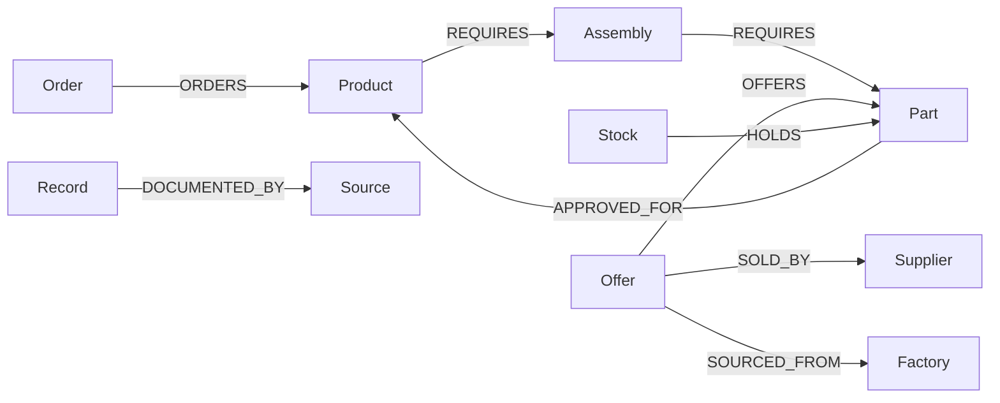
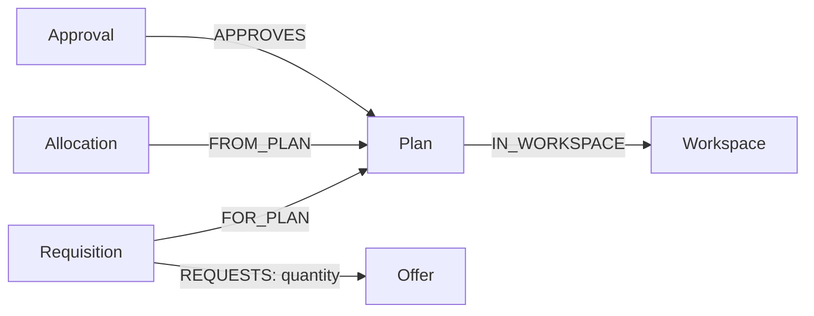

# Architecture

Reflow separates investigation, constraint checks and approved actions. FalkorDB is the domain store, not a visualization cache.

## Graph model

Each authorized workspace has a separate graph. A signed browser cookie holds workspace membership; graph IDs supplied by a visitor cannot override that membership. Local MCP operators inherit their database access.



Source-backed records retain their structured input as JSON scalar properties. Mutable stock reservations, expected offer allocations, workspace revisions and plan status are separate graph properties. Plan, Approval, Allocation, Requisition and Activity nodes record the recovery workflow.

The initial schema represents one critical component per product and an explicit assembly stage. It does not ingest arbitrary manufacturing BOMs or establish independence outside the supplied network.

## Recovery records

The workflow adds these persisted relationships after investigation and approval:



The disruption and revision are properties of `Workspace`. Allocation detail, including its order ID and stock/offer quantities, is stored as JSON on `Allocation`. `Activity` nodes retain actual MCP tool inputs, outputs and timings within the workspace graph. Their records are separate from the supply network.

## Essential Cypher

The impact query follows an actual variable-length dependency path, including assemblies, from an exposed offer to customer orders:

```cypher
MATCH p=(f:Factory {id:$factory})<-[:SOURCED_FROM]-(offer:Offer)
  -[:OFFERS]->(part:Part)<-[:REQUIRES*1..5]-(product:Product)
  <-[:ORDERS]-(o:Order)
RETURN o.id AS orderId,
       [n IN nodes(p) | n.id] AS ids,
       [n IN nodes(p) | coalesce(n.name,n.id)] AS names
```

Replacement exposure is queried independently of supplier name:

```cypher
MATCH p=(o:Offer)-[:SOURCED_FROM*1..5]->(f:Factory {id:$factory})
RETURN o.id AS id,
       [n IN nodes(p) | n.id] AS ids,
       [n IN nodes(p) | coalesce(n.name,n.id)] AS names
```

Approval edges determine which product specifications permit a component:

```cypher
MATCH (o:Offer)-[:OFFERS]->(p:Part)-[:APPROVED_FOR]->(product:Product)
RETURN o.id AS id, collect(product.id) AS products
```

Queries are parameterized and executed only within the authorized graph. See `src/graph/store.ts` for executable queries and the guarded write transaction.

## Investigation and planning

The official MCP SDK exposes trace, offer lookup, source reading and recovery evaluation tools. The app connects its MCP client/server over linked in-memory transports; the same server supports stdio. In autonomous mode the configured model selects the investigation tools. In guided mode a fixed, explicitly labeled sequence invokes the same MCP operations.

A deterministic bounded search ranks allocations by complete on-time orders, earlier deadlines, total coverage, then lower additional and purchase cost. It enforces recorded component approval/voltage, quote validity, factory exposure, independent finished stock, available quantity, assembly capacity, dates and premium cap. It reports search-limit exhaustion. A separate validator checks the resulting proposal.

The UI renders actual query-returned evidence paths and tool events. Numerical explanations are generated from checked plan values; free-form model prose is not displayed as a business result. Proposals do not execute procurement.

## Approval and readback

Approval creates a server-side token linked to the exact proposal and revision. A single graph write checks the token, workspace revision and proposed status, then creates internal allocations and one draft requisition while incrementing the revision. This compare-and-set guard prevents two competing plans from committing at the same revision. Repeated execution reads the existing result.

An independent query compares saved allocation JSON, stock and expected-supply counts, requisition identity/status and requested offer quantities. Only then does the plan become verified. A committed recovery closes planning for that scenario. New comparisons use a fresh workspace so customer demand cannot be allocated twice.

## Scope

Prices use integer USD cents; dates use scenario-relative day numbers. A complete order must have all components and meet its deadline. Expected quoted supply is not received inventory. No external stock reservation, order placement, payment, shipping or delivery confirmation occurs.

This preview supports at most three customer orders, four supplier offers and 250 ordered units. It uses process-local run quotas and a single application instance. Accounts, team permissions, retention jobs, managed backups, multi-instance quotas and production procurement integration require additional work.
